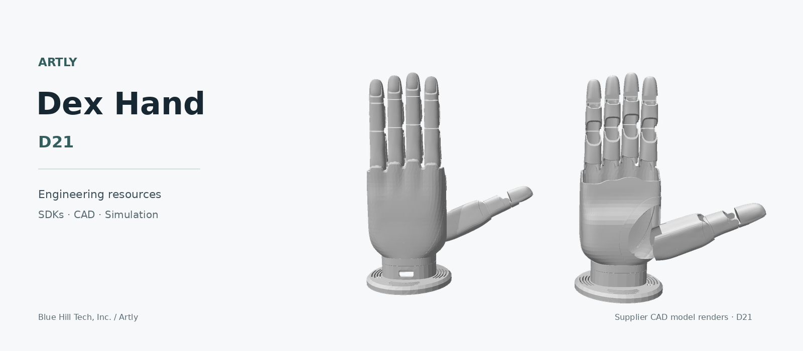

# Artly Dex Hand

**Dexterous robot hands from Artly.**

Engineering resources for the Artly Dex Hand product family by
**Blue Hill Tech, Inc. (DBA Artly)**. **D21** is the first model, with Python and
ROS2 integration, CAD, simulation models and technical documentation available here.

[Explore D21](docs/models/d21.md) · [Get started](docs/setup.md) ·
[Documentation](docs/README.md) · [Downloads](vendor/README.md)



*D21 simulation geometry. This is a model render, not a product photograph.*

## Meet D21

| Model | Motion | Interfaces | Developer resources |
| --- | --- | --- | --- |
| **[D21](docs/models/d21.md)** | 21 total / 16 active degrees of freedom | RS485 · CAN FD | Python · ROS2 · URDF · MuJoCo · STEP CAD |

Specifications are supplier-reported;
physical performance has not been independently validated. Only D21 resources
are included today. Model-specific D21 names remain in the code and assets for compatibility.

## Start building

| Your task | Start here |
| --- | --- |
| Understand the hardware | [D21 specifications and interfaces](docs/models/d21.md) |
| Set up Python or ROS2 | [Installation and setup](docs/setup.md) |
| Explore the API | [Python SDK](sdk/python) and [API reference](sdk/python/API.md) |
| Load a model | [Simulation guide](docs/setup.md#standalone-simulation) and [model files](simulation) |
| Design a mount | [Hand and RealMan adapter CAD](cad) and [mechanical reference](docs/reference/zh/mechanical-interface.pdf) |
| Find available files | [Resource availability](vendor/README.md) |

### First check: import the Python SDK

From a Linux/macOS shell with Python 3.12 installed:

```bash
git clone https://github.com/Blue-Hill-Tech/artly-dex-hand.git
cd artly-dex-hand
python3.12 -m venv .venv
. .venv/bin/activate
python -m pip install 'pyserial==3.5' 'python-can==4.6.1'
cd sdk/python
python -B -c 'import D21ModbusCore, d21_rs485, CANFDDevice, d21_canfd'
```

This checks imports without opening a device. The pins reproduce the reviewed
driver dependencies; hardware and platform qualification are separate.
The [setup guide](docs/setup.md) covers other environments and ROS2.

> **Before connecting hardware:** the supplier's `example.py` sends motion commands,
> and ROS2 defaults to hardware mode with a zero-target write at startup. Use
> `use_simulation:=true` for offline ROS2 work. Review the
> [known SDK limitations](docs/validation.md#confirmed-implementation-limitations) first.

## What's included

```text
sdk/           Python modules and ROS2 hand_control package
docs/          Setup, model specifications and technical references
cad/           STEP hand model and mounting adapter
simulation/    Left/right URDF, MuJoCo XML, meshes and examples
media/         Model render and original reference images
vendor/        Resource availability and distribution notes
provenance/    Published asset hashes and validation records
tools/         Asset verification and offline checks
```

No Git LFS setup is needed. [The media index](media/README.md) identifies the
available reference images; no demonstration videos were found. The Windows
controller and original source packages are not distributed in this repository.

## Engineering status

Source hashes, archive integrity, Python imports, pure protocol checks and
headless model loading/stepping have been reviewed. Hardware operation, full
ROS2 runtime and physical performance remain unqualified. Known Modbus response
and CAN FD configuration defects are documented in the
[validation record](docs/validation.md).

Use [the asset manifest](provenance/asset-manifest.json) to verify the published
engineering assets. [The documentation index](docs/README.md)
provides the complete reference set.

## Attribution and licensing

Third-party materials remain subject to their applicable license terms.
This repository does not apply a blanket open-source license to all materials. See [NOTICE.md](NOTICE.md) for the supplied license notices and scope.
