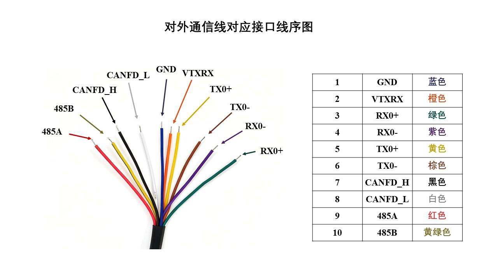

# Image and video index

## D21 model render


The repository banner renders the supplied left/right URDF and STL geometry in
PyBullet without hardware or physics execution. It is a model illustration,
not a physical product photograph. Original geometry and materials are unchanged;
camera, lighting and model placement are chosen for presentation.

[Render provenance](../provenance/model-render.json) records source hashes,
dependencies and the output hash. To reproduce it with PyBullet, NumPy, Pillow
and DejaVu Sans fonts installed:

```bash
python tools/render_d21.py --models simulation --output /tmp/d21-model-render.png
```

## Technical reference images

Four reference images are included. They cover installation, electrical
connections and status indicators. They are technical source material rather
than a product photography set. Original image bytes are retained, including
the sideways orientation of two photographed sheets.

| Image | Description | Dimensions |
| --- | --- | --- |
| [IMG_9863.jpg](images/IMG_9863.jpg) | Bilingual mechanical installation sheet, hand/base photos and dimensions | 3024 × 4032 |
| [IMG_9864.jpg](images/IMG_9864.jpg) | Bilingual power/communication wiring and PC/adapter diagram; sideways | 4032 × 3024 |
| [IMG_9865.jpg](images/IMG_9865.jpg) | Bilingual RGB button/indicator explanation; sideways | 4032 × 3024 |
| [Electrical interface](images/electrical-interface.jpg) | Ten-wire signal/color diagram | 1280 × 720 |



Verify the exact hardware revision and connector orientation against the
[electrical reference](../docs/reference/zh/electrical-interface.pdf) before wiring.

The [product review](../docs/product-review.md) summarizes technical findings and
source limitations. The [video availability note](videos/README.md) records the
remaining demonstration media gap. See [the manifest](../provenance/asset-manifest.json)
for published asset paths, sizes and hashes.
